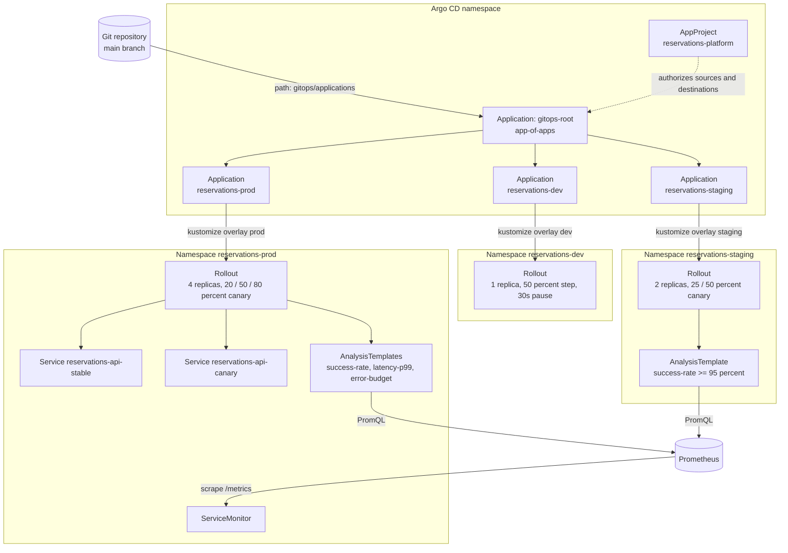

# GitOps Platform (Argo CD)

A production-style GitOps setup for **reservations-api**, a Node.js service that books shared resources (meeting rooms, desks) and exposes Prometheus metrics used during progressive delivery. [Argo CD](https://argo-cd.readthedocs.io/) watches this repository with an app-of-apps root Application and syncs independent Applications for `dev`, `staging` and `prod`. [Argo Rollouts](https://argo-rollouts.readthedocs.io/) shifts traffic through a canary `Rollout`, and Prometheus `AnalysisTemplate` checks decide whether a production or staging step is allowed to continue.

> **Status:** nothing in this repository has been deployed anywhere. Manifests and the API are validated offline (see [Validation](#validation)). GitHub Actions is disabled for this repository. The container image has not been built or published.

## Architecture



## How it works

1. **App-of-apps.** `gitops/bootstrap/root-application.yaml` is the single object you apply to a cluster that already runs Argo CD. It syncs every Application manifest under `gitops/applications/`. Each child Application points at one Kustomize overlay, so an environment can drift or roll back without touching the others.
2. **AppProject.** `gitops/bootstrap/project.yaml` restricts those Applications to this repository and to the `reservations-*` namespaces (plus `argocd` and `monitoring`).
3. **The workload** is an Argo Rollouts `Rollout`, not a Kubernetes `Deployment`. The controller copies the desired weight onto the canary ReplicaSet and keeps the stable ReplicaSet serving the rest of the traffic through `reservations-api-stable` and `reservations-api-canary`.
4. **Canary analysis.** Staging and production steps run `AnalysisTemplate` objects that query Prometheus. Production requires a 99 percent success rate, p99 latency at or below 500 ms, and a 5xx ratio at or below 1 percent. Queries use `clamp_min(..., 0.001)` so an idle service does not divide by zero and flip the analysis to `Inconclusive`.
5. **The API** records `http_requests_total` and `http_request_duration_seconds` (with `/api/reservations/:id` normalized so IDs never become metric labels). `ERROR_RATE` and `EXTRA_LATENCY_MS` can inject faults so an analysis can be shown failing without changing application code. Probes and `/metrics` are excluded from injection.
6. **Configuration** is merged per overlay through `configMapGenerator`, which adds a content hash to the ConfigMap name. `kustomizeconfig.yaml` teaches Kustomize to update the `Rollout` `envFrom` reference, so a config change starts a new canary.

### Environment differences

| Setting | base | dev | staging | prod |
|---|---|---|---|---|
| Namespace | unset | `reservations-dev` | `reservations-staging` | `reservations-prod` |
| Replicas | 1 | 1 | 2 | 4 |
| Canary steps | services only | 50 percent, 30s pause | 25 percent, success-rate, 50 percent | 20 / 50 / 80 percent with background and step analysis |
| Analysis threshold | templates default to 99 percent success, 500 ms p99, 1 percent 5xx | none | success-rate 95 percent | success-rate 99 percent, p99 latency, error-budget |
| Log level | info | debug | info | warn |
| PDB minAvailable | 1 | 1 | 1 | 2 |
| CPU request / limit | 100m / 500m | 50m / 250m | 100m / 500m | 200m / 1 |
| Memory request / limit | 64Mi / 128Mi | 48Mi / 96Mi | 64Mi / 128Mi | 128Mi / 256Mi |
| Ingress | none | none | `reservations-staging.localtest.me` | `reservations.example.com` with TLS |
| Image | `reservations-api:1.0.0` | `reservations-api:1.0.0` | `reservations-api:1.0.0` | `ghcr.io/shubhamkhedkar/reservations-api:1.0.0` |
| Spread / anti-affinity | none | none | none | `DoNotSchedule` spread, preferred anti-affinity |

## Repository layout

```
.
├── app/                         # reservations-api (zero-dependency Node.js 20)
│   ├── Dockerfile               # test stage runs unit tests; runtime runs as uid 1000
│   ├── src/                     # HTTP API, reservation store, Prometheus metrics
│   └── test/                    # node:test suite
├── gitops/
│   ├── bootstrap/               # AppProject + root Application (apply these first)
│   ├── applications/            # child Applications synced by the root app-of-apps
│   └── apps/reservations/
│       ├── base/                # Rollout, Services, PDB, ServiceMonitor, AnalysisTemplates
│       └── overlays/            # dev, staging, prod
├── scripts/
│   ├── validate.sh              # offline tests and schema checks
│   ├── bootstrap.sh             # optional: install Argo CD / Rollouts and apply the root app
│   └── cleanup.sh               # delete Applications and namespaces
└── test/gitops.test.js          # structure checks for app-of-apps, overlays and analysis
```

## Prerequisites

- Node.js 20 or newer, to run the API and its unit tests
- [kustomize](https://kubectl.docs.kubernetes.io/installation/kustomize/) v5.x and [kubeconform](https://github.com/yannh/kubeconform) for `make validate`
- Optional: shellcheck, hadolint
- To sync this onto a cluster later: `kubectl`, a Kubernetes cluster, [Argo CD](https://github.com/argoproj/argo-cd), [Argo Rollouts](https://github.com/argoproj/argo-rollouts), and a Prometheus instance that kube-prometheus-stack (or equivalent) scrapes through the `ServiceMonitor`

## Step-by-step: run the API locally

1. **Clone the repository**
   ```bash
   git clone https://github.com/shubhamkhedkar/gitops-platform-argocd.git
   cd gitops-platform-argocd
   ```
2. **Run the offline checks** (no cluster required)
   ```bash
   make validate
   ```
3. **Start the API**
   ```bash
   API_KEY=example-api-key-change-me APP_ENV=dev node app/src/server.js
   ```
4. **Exercise the endpoints**
   ```bash
   curl -s localhost:8080/api/reservations | jq
   curl -s -X POST localhost:8080/api/reservations \
     -H 'x-api-key: example-api-key-change-me' -H 'content-type: application/json' \
     -d '{"resource":"room-c","requester":"casey","start":"2026-11-08T16:00:00Z","end":"2026-11-08T17:00:00Z","purpose":"retro"}'
   curl -s localhost:8080/metrics | head
   ```
5. **Preview the manifests Argo CD would sync**
   ```bash
   make render-dev
   make render-staging
   make render-prod
   ```

## Step-by-step: sync with Argo CD later

These steps create cluster objects. They are documented so you can run them yourself; they are not executed by the checks in this repository.

1. Install Argo CD and Argo Rollouts, then apply the root Application:
   ```bash
   ./scripts/bootstrap.sh
   ```
   Or apply the two bootstrap manifests after installing those controllers yourself:
   ```bash
   kubectl apply -f gitops/bootstrap/project.yaml
   kubectl apply -f gitops/bootstrap/root-application.yaml
   ```
2. Build and load the image for `dev` and `staging` (`reservations-api:1.0.0`). Production references `ghcr.io/shubhamkhedkar/reservations-api:1.0.0`; point that tag at your registry before using the prod overlay.
3. Confirm the three child Applications appear in Argo CD and sync the `reservations-*` namespaces.
4. Trigger a canary by changing `APP_VERSION` (or any generated ConfigMap value) in an overlay and committing to `main`. Staging and production should pause on analysis; production should abort if you temporarily set `ERROR_RATE=1` and generate traffic.

Prometheus must be reachable at the address in the AnalysisTemplates (`http://kube-prometheus-stack-prometheus.monitoring.svc.cluster.local:9090` by default). Change the `prometheus-address` argument if your service DNS differs.

## Secrets

`gitops/apps/reservations/base/secret.yaml` holds **example values only** so the overlays render out of the box. Before any shared environment, remove it from the base and supply the Secret with [Sealed Secrets](https://github.com/bitnami-labs/sealed-secrets), the [External Secrets Operator](https://external-secrets.io/), SOPS-encrypted files, or a one-off create:

```bash
kubectl -n reservations-prod create secret generic reservations-api-secret \
  --from-literal=API_KEY="$(openssl rand -hex 24)"
```

The prod Ingress references `reservations-api-tls`. Create that certificate Secret (or use cert-manager) before enabling TLS.

## API reference

| Method | Path | Description |
|---|---|---|
| GET | `/` | Service name, environment and version |
| GET | `/version` | Version, git SHA and environment |
| GET | `/api/info` | Runtime settings and pod identity (secret values are never returned) |
| GET | `/api/resources` | Distinct resources that currently have reservations |
| GET | `/api/reservations` | List reservations; `?resource=` filters by resource |
| GET | `/api/reservations/:id` | Fetch one reservation |
| POST | `/api/reservations` | Create a reservation (`x-api-key` required); overlapping bookings on the same resource return 409 |
| DELETE | `/api/reservations/:id` | Cancel a reservation (`x-api-key` required) |
| GET | `/metrics` | Prometheus metrics |
| GET | `/startupz` | Startup probe |
| GET | `/healthz` | Liveness probe |
| GET | `/readyz` | Readiness probe |

`ERROR_RATE` (0–1) and `EXTRA_LATENCY_MS` apply only to `/` and `/api/*`. They are the knobs a canary analysis watches when you want a step to fail or slow down on purpose.

## Validation

`make validate` (or `scripts/validate.sh`) runs everything that does not need a cluster:

- reservations-api unit tests with `node --test`
- GitOps structure tests (`test/gitops.test.js`) for the app-of-apps graph, overlay differences and analysis queries
- `kustomize build` of the base plus each overlay, piped into `kubeconform -strict` against Kubernetes 1.30 and the published Argo CD, Argo Rollouts and ServiceMonitor CRD schemas
- `shellcheck` on every script
- `hadolint` on the Dockerfile

The following were **not** run against this repository: `docker build`, image publishes, `terraform apply`, kind/minikube/cluster creation, `kubectl apply`, Argo CD sync, Argo Rollouts promotion, or live Prometheus queries.

## Cleanup

```bash
./scripts/cleanup.sh        # delete Applications, the AppProject and reservations-* namespaces
./scripts/cleanup.sh --all  # also delete the argocd and argo-rollouts namespaces
```

Leave Prometheus and any shared ingress controller in place unless you installed them only for this project.

## Reference

GitOps Application and AppProject manifests follow patterns from [Argo CD](https://github.com/argoproj/argo-cd) (Apache License 2.0). Progressive delivery objects (`Rollout`, `AnalysisTemplate`) follow [Argo Rollouts](https://github.com/argoproj/argo-rollouts) (Apache License 2.0). Analysis queries use the Prometheus query language documented by [Prometheus](https://github.com/prometheus/prometheus) (Apache License 2.0). This repository is original application code and configuration; it does not copy those projects' source.

## License

MIT
